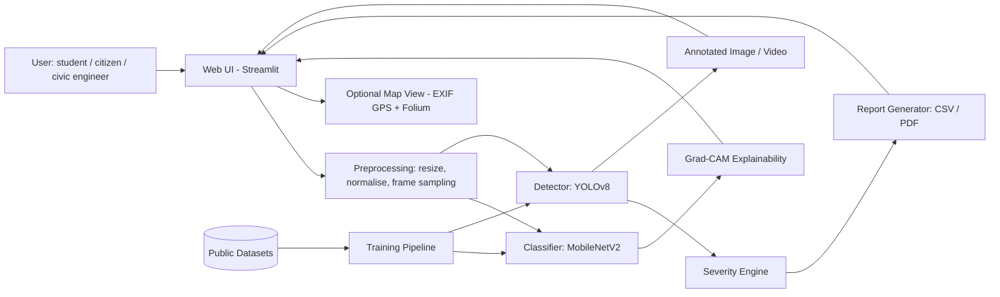
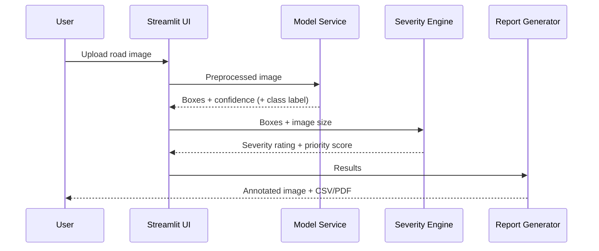

# RoadWatch: Pothole Detection from Road Images using Deep Learning

**Course:** Community / Societal Project (1BCP308), VTU, Semester 3
**Team:** [Team name] | [Member 1], [Member 2], [Member 3], [Member 4]
**Guide:** [Guide name] | **Department:** [Department]
**SDGs addressed:** SDG 9 (Industry, Innovation and Infrastructure), SDG 11 (Sustainable Cities and Communities), SDG 3 (Good Health and Well-being, via road safety)
**Programme Outcome focus:** PO 5, PO 6 (modern tool usage, engineer and society)

---

## 1. Project Overview

RoadWatch is a software-only web application that uses a deep learning model to detect potholes in road images or video. It marks each pothole on the image, estimates how severe it is, and produces a downloadable report that a municipal body, a civil engineer or a community group can use to prioritise repairs.

**One-line pitch:** Turn any road photo into an instant, explainable pothole report, with no special hardware and no manual inspection.

---

## 2. Background and Problem Statement

### 2.1 Background
Potholes form when water seeps into cracks in the road surface and traffic then breaks the weakened layer apart. They are most common after the monsoon. They damage vehicles, cause two-wheeler falls and accidents, slow traffic and increase maintenance costs.

Road condition monitoring is mostly manual: inspectors drive or walk along roads, or authorities wait for citizen complaints. This approach has three weaknesses:
1. **Slow:** damage is found only after it has become dangerous.
2. **Unscalable:** city and rural road networks are too long to inspect regularly.
3. **Subjective:** different inspectors describe severity differently, which makes repair prioritisation inconsistent.

> *To add in the report:* official accident and pothole-related casualty figures from the Ministry of Road Transport and Highways (MoRTH) annual report "Road Accidents in India", and a couple of recent news reports on pothole-related accidents. Cite the exact year and page. Do not quote numbers without a source.

### 2.2 Problem Statement
> Manual road inspection is slow, subjective and unable to cover entire road networks, so potholes stay undetected until they cause accidents or vehicle damage. There is no simple, low-cost tool that lets a student, citizen group or local body upload ordinary road images and automatically get pothole locations within the image, a consistent severity rating and a summary report for repair prioritisation.

### 2.3 Objectives
1. Study existing pothole detection approaches (manual, sensor-based, image-based) and identify gaps. *(Review 1)*
2. Build a labelled pothole dataset pipeline from free public datasets, with cleaning, splitting and augmentation.
3. Train a baseline image classifier (pothole / no pothole) using transfer learning.
4. Train an object detector (YOLO) that localises potholes with bounding boxes.
5. Evaluate both models with proper metrics (accuracy, precision, recall, F1, mAP) and compare them.
6. Implement a severity rating (Low / Medium / High) based on pothole size relative to the image.
7. Build a web application to upload images or video, see annotated results and download a report (CSV and PDF/HTML).
8. Deploy a free public demo and document the system, test results, societal impact and sustainability.

### 2.4 Target Metrics (set before experiments, report honestly)
| Metric | Target |
|---|---|
| Classifier accuracy and recall (pothole class) | ≥ 90% accuracy, ≥ 90% recall on the held-out test set |
| Detector mAP@0.5 | ≥ 0.60 (a reasonable target for small public datasets) |
| Inference time per image (CPU) | ≤ 3 seconds |
| App usability | A new user can get a result within 3 clicks |

Targets are goals. If results are lower, explain why (dataset size, image quality) in the report, since this gives better marks than inflated numbers.

---

## 3. Scope, Assumptions and Limitations

**In scope**
- Detection of potholes on paved roads in daylight images.
- Single images and short videos (frame sampling).
- Severity estimate and report generation.
- Optional location display if the image contains GPS EXIF data.

**Out of scope**
- Real-time deployment on vehicles, drones or dashcam hardware.
- Measuring true pothole depth (a single camera image cannot give it reliably).
- Night, heavy rain and unpaved road conditions.
- Automatically filing complaints with authorities.

**Assumptions:** public datasets are representative enough of road surfaces; the user provides a reasonably clear, front-facing road photo.

**Known limitations (state these in the report):** severity depends on camera distance and angle, so it is a relative indicator and not an engineering measurement; shadows, puddles, patched tarmac and manhole covers can cause false positives; public datasets may not cover all Indian road types.

---

## 4. Existing Solutions and Gap Analysis

| Approach | How it works | Limitation |
|---|---|---|
| Manual inspection | Inspectors survey roads | Slow, costly, subjective, low coverage |
| Citizen complaints | Residents report potholes | Depends on public awareness, no verification, inconsistent details |
| Vibration / accelerometer sensing | Phone or vehicle sensors detect bumps | Needs driving over the pothole, poor localisation, cannot see it beforehand |
| 3D laser / LiDAR scanning | Specialised vehicles scan the surface | Very expensive, not available to small local bodies |
| Image-based deep learning | A model detects potholes in photos | Needs training data and expertise; most research stays as prototypes |

**Gap:** a simple, free, explainable web tool combining detection, severity rating and a report that a non-expert can use.

*Literature survey task for Review 1:* read and summarise 5–8 papers on pothole detection using CNNs/YOLO (search Google Scholar, IEEE Xplore, arXiv) and add them as a comparison table: paper, year, method, dataset, reported result, limitation.

---

## 5. Proposed Solution

RoadWatch has two ML stages plus an application layer.

**Stage A: Baseline classifier (image level).** Transfer learning with MobileNetV2 (or ResNet18) predicts whether an image contains a pothole. It is fast, easy to train and a good baseline. Grad-CAM heatmaps show which regions influenced the decision (explainability).

**Stage B: Detector (object level).** A YOLO model (for example YOLOv8n/s via the `ultralytics` library) predicts a bounding box for each pothole with a confidence score.

**Stage C: Severity and reporting.**
- Severity ratio = bounding-box area ÷ image area (summed across potholes).
- Illustrative thresholds: **Low** < 2%, **Medium** 2–8%, **High** > 8%. Tune these on the validation set and, if possible, check them with one civil engineering faculty member.
- Output: annotated image, pothole count, per-pothole confidence and severity, overall road-segment priority score, and CSV/PDF report.

**Why two models?** The classifier gives a quick, simple baseline for comparison, and the detector gives the precise localisation the application needs. Comparing them gives a real analysis section for the report.

---

## 6. Data Plan (all free and online, no survey needed)

### 6.1 Sources (verify the licence of each before use)
- Kaggle pothole datasets (search "pothole detection", pick datasets with bounding box annotations in YOLO or Pascal VOC format).
- Roboflow Universe pothole datasets (many are exportable in YOLO format).
- Normal road images from the same datasets or any open road-image set for the "no pothole" class.

### 6.2 Preparation steps
1. Download and merge two or three datasets, then keep a record of the source of each image.
2. Remove duplicates and corrupt files.
3. Convert all annotations to YOLO format.
4. **Split by source and sequence, not randomly.** Video frames from the same road are nearly identical, so a random split leaks data and inflates accuracy. Keep all frames of one video in one split.
5. Split roughly 70% train, 15% validation, 15% test.
6. Check class balance and apply augmentation (flip, brightness/contrast, slight rotation, blur, random crop) to the training set only.

### 6.3 Dataset documentation table (put in report)
| Item | Value |
|---|---|
| Number of images (train/val/test) | [fill] |
| Number of pothole instances | [fill] |
| Image resolution range | [fill] |
| Sources and licences | [fill] |

---

## 7. System Design and Architecture

### 7.1 High-Level Architecture



### 7.2 Layers
| Layer | Responsibility | Technology |
|---|---|---|
| Presentation | Upload, display results, download report | Streamlit |
| Application | Orchestrates processing, severity logic, reports | Python |
| ML inference | Classification, detection, explainability | PyTorch / TensorFlow, Ultralytics |
| Data and training | Dataset prep, training, evaluation | Python, Google Colab / Kaggle GPU |
| Deployment | Free hosting | Hugging Face Spaces or Streamlit Community Cloud |

### 7.3 Workflow (user flow)
1. The user uploads an image (or short video).
2. The app validates the file type and size, then resizes and normalises the image.
3. The detector finds potholes and returns boxes and confidences.
4. The severity engine computes the area ratio and assigns a rating.
5. The app shows the annotated image, count, severity and heatmap (optional).
6. The user downloads a CSV/PDF report.
7. If the image has GPS EXIF metadata, the app plots it on a map.

### 7.4 Sequence of processing



### 7.5 Suggested Folder Structure
```
roadwatch/
├── data/
│   ├── raw/
│   ├── processed/        # train / val / test, YOLO format
│   └── data.yaml
├── notebooks/
│   ├── 01_eda.ipynb
│   ├── 02_classifier_baseline.ipynb
│   └── 03_yolo_training.ipynb
├── src/
│   ├── preprocess.py
│   ├── infer.py          # load models, run detection
│   ├── severity.py       # area ratio and rating
│   ├── report.py         # CSV / PDF generation
│   └── gradcam.py
├── models/               # trained weights
├── app.py                # Streamlit app
├── tests/
├── requirements.txt
└── README.md
```

### 7.6 Technology Stack
- **Language:** Python 3.10+
- **ML:** PyTorch or TensorFlow/Keras, Ultralytics YOLO, OpenCV, scikit-learn (metrics)
- **App:** Streamlit
- **Reports/maps:** pandas, reportlab or fpdf, folium, Pillow (EXIF)
- **Training environment:** Google Colab or Kaggle (free GPU)
- **Version control:** Git and GitHub
- **Deployment:** Hugging Face Spaces or Streamlit Community Cloud

---

## 8. ML Methodology

### 8.1 Baseline classifier
- Pretrained MobileNetV2 (ImageNet weights), classification head replaced by 2 classes.
- Step 1: freeze the backbone and train the head for 5–10 epochs. Step 2: unfreeze the last blocks and fine-tune with a low learning rate (for example 1e-4).
- Loss: cross-entropy. Optimiser: Adam. Input size: 224×224. Early stopping on validation loss.

### 8.2 YOLO detector
- Start from pretrained `yolov8n` (fast) and compare with `yolov8s` if time allows.
- Image size 640, 50–100 epochs, default augmentations, best weights chosen on validation mAP.
- Tune confidence threshold (for example 0.25–0.5) to balance false alarms against missed potholes.

### 8.3 Evaluation
| Model | Metrics |
|---|---|
| Classifier | Accuracy, precision, recall, F1, confusion matrix, ROC-AUC |
| Detector | Precision, recall, mAP@0.5, mAP@0.5:0.95, PR curve |
| System | Inference time per image, end-to-end tests on unseen images |

**Priority:** recall for the pothole class matters most, because a missed pothole is more harmful than a false alarm.

### 8.4 Error analysis (required for good marks)
Inspect false positives and false negatives and group the causes: shadows, wet road, manhole covers, patched road, blur, small or distant potholes. Include 6–10 example images with explanations and describe the improvements that would fix them.

### 8.5 Experiments to report
1. Classifier vs detector comparison.
2. With vs without augmentation.
3. `yolov8n` vs `yolov8s`.
4. Effect of the confidence threshold on precision and recall.

---

## 9. Implementation Plan

### 9.1 Team roles (for 4 members, adjust for fewer)
| Member | Role | Key tasks |
|---|---|---|
| 1 | Data lead | Dataset collection, cleaning, annotation conversion, EDA |
| 2 | ML lead | Classifier training, evaluation, Grad-CAM |
| 3 | ML/Detection lead | YOLO training, tuning, error analysis |
| 4 | App and documentation lead | Streamlit app, severity engine, report generator, deployment |

All members contribute to the report and the presentation. Record individual contribution inside the documentation, since the evaluation adjusts marks per student.

### 9.2 Timeline aligned to the college schedule
The following assumes work starts the week of 9 November 2026. Adjust it with your guide.

| Dates | Milestone | Output |
|---|---|---|
| 9–13 Nov | Finalise topic and problem statement, get guide approval, finish literature survey, collect datasets | Approved proposal, literature table, dataset folder |
| 14–20 Nov | Data cleaning, EDA, baseline classifier | Notebook, baseline metrics |
| 21–27 Nov | YOLO training, severity engine, first working app | Working prototype/MVP |
| 28–30 Nov | Testing, error analysis, report writing, deployment | Test results, draft report, live demo link |
| **1–3 Dec** | **Review 3: final demo and evaluation** | Final working model, report, presentation |
| 4–8 Dec | Polish UI, prepare poster and exhibition demo | Slides, poster |
| **9 Dec** | **Department-level mini-project exhibition** | Live demo |
| **17 Dec** | **College-level exhibition** | Live demo |

### 9.3 Core algorithm (severity)
```text
for each detected pothole box:
    ratio = box_area / image_area
total_ratio = sum(ratios)
severity = Low if total_ratio < 0.02
           Medium if 0.02 <= total_ratio < 0.08
           High otherwise
priority_score = f(count, total_ratio, max_confidence)
```

---

## 10. Starter Code

### 10.1 Train the YOLO detector
```python
from ultralytics import YOLO

model = YOLO("yolov8n.pt")
model.train(data="data/data.yaml", epochs=60, imgsz=640, batch=16)
metrics = model.val()          # mAP, precision, recall
```

`data.yaml`:
```yaml
path: data/processed
train: images/train
val: images/val
test: images/test
names:
  0: pothole
```

### 10.2 Run inference and compute severity
```python
from ultralytics import YOLO
import cv2

model = YOLO("models/best.pt")

def analyse(image_path, conf=0.35):
    img = cv2.imread(image_path)
    h, w = img.shape[:2]
    result = model.predict(img, conf=conf)[0]
    boxes = result.boxes.xyxy.cpu().numpy()
    confs = result.boxes.conf.cpu().numpy()
    areas = [(x2 - x1) * (y2 - y1) for x1, y1, x2, y2 in boxes]
    ratio = sum(areas) / (w * h)
    severity = "Low" if ratio < 0.02 else "Medium" if ratio < 0.08 else "High"
    return result.plot(), len(boxes), ratio, severity, confs
```

### 10.3 Streamlit app skeleton
```python
import streamlit as st
import numpy as np
from PIL import Image
from src.infer import analyse_image   # wrap the function above

st.title("RoadWatch: Pothole Detection")
file = st.file_uploader("Upload a road image", type=["jpg", "jpeg", "png"])
conf = st.slider("Confidence threshold", 0.1, 0.9, 0.35)

if file:
    img = Image.open(file).convert("RGB")
    annotated, count, ratio, severity, confs = analyse_image(np.array(img), conf)
    st.image(annotated, caption=f"{count} pothole(s) | severity: {severity}")
    st.metric("Affected area ratio", f"{ratio:.1%}")
```

---

## 11. Testing Plan

| Type | What is tested | Pass criterion |
|---|---|---|
| Data tests | No duplicates across splits, labels valid | Zero leakage |
| Model tests | Metrics on the untouched test set | Meets the targets in 2.4, or is honestly explained |
| Unit tests | Severity function, file validation, report generator | All pass |
| Functional tests | Upload, detect, download for JPG/PNG/video | Works without errors |
| Robustness | Blurred, dark, shadowed and wet-road images | Failures are documented |
| Performance | Time per image on CPU | ≤ 3 s |
| Usability | 5–10 classmates try the app and answer a 3-question form | Task completed without help |

The usability test uses classmates inside the college, so it needs no outside survey.

---

## 12. Societal Impact, Stakeholders and Sustainability

**Beneficiaries and stakeholders**
- Road users, especially two-wheeler riders and pedestrians (safety).
- Municipal bodies and road authorities (faster, consistent prioritisation).
- Civil engineering students and resident welfare associations (a free inspection aid).
- NGOs and citizen groups working on road safety.

**Impact (state qualitatively and back with public statistics)**
- Safer roads through earlier detection.
- Lower inspection effort and more objective prioritisation.
- Free, open tool usable by small local bodies that cannot afford specialised systems.

**Sustainability and scaling (the evaluation asks for scaling recommendations)**
- Open-source code on GitHub with a clear README.
- Free hosted demo, so no running costs.
- The model can be retrained as new public data appears.
- Scaling path: batch processing of dashcam or drone footage, a map dashboard combining reports from many images, integration with civic complaint platforms, a mobile app.

**Lightweight stakeholder interaction (without a survey):** review published municipal and MoRTH material and news reports on the problem; and ask your guide or a civil engineering faculty member for feedback on the severity thresholds and report format. Record these as meeting notes for the documentation.

---

## 13. Ethics, Professional Conduct and Risks

- **Politically neutral and academic:** the tool reports road condition only and does not target any authority or area.
- **Privacy:** blur faces and vehicle number plates in any image you display publicly, or use only datasets that permit redistribution.
- **Licences:** record the licence of each dataset and credit the authors.
- **Responsible use:** state clearly that outputs are decision-support, and inspection by qualified engineers must confirm any repair decision.

| Risk | Likelihood | Mitigation |
|---|---|---|
| Low accuracy on Indian roads | Medium | Merge multiple datasets, augmentation, report limitations honestly |
| Data leakage inflating results | Medium | Split by source/sequence |
| GPU time limits on free tiers | Medium | Use `yolov8n`, save checkpoints, train in short sessions |
| Deployment issues | Low | Test early, keep a recorded demo video as a backup |
| Time shortage before Review 3 | Medium | Finish the classifier plus a basic app first, then improve |

---

## 14. Mapping to Syllabus and College Evaluation

### 14.1 Course outcomes
| CO | How this project addresses it |
|---|---|
| CO1 | Problem identified and analysed through literature, reports and public data |
| CO2 | Planning, data collection from public sources, implementation, documentation |
| CO3 | Socially responsible engineering through a public-safety tool |
| CO4 | Data-driven analysis, error analysis, multidisciplinary (ML plus civil infrastructure) |
| CO5 | Feasible scope chosen with stated constraints |
| CO6 | A deployed product usable by the intended community |

### 14.2 College review checklist
**Review 1 (proposal and planning, 15 marks)**
- Problem identification and societal relevance (4): Sections 2.1 and 12.
- Problem statement and objectives (4): Sections 2.2 and 2.3.
- Preliminary stakeholder interaction (2): lightweight approach in Section 12.
- Initial documentation and planning (2): Sections 4 and 9.
- Teamwork and presentation (3): roles in Section 9.1.

**Review 2 (prototype, 15 marks)**
- Problem refinement and feasibility (3), engineering approach (4): Sections 5–8.
- Implementation and demo (4): working app plus baseline metrics.
- Documentation and problem-solving (2), involvement (2): challenges log and contribution record.

**Review 3 (final, 20 marks)**
- Technical solution and testing (4): Sections 8 and 11.
- Final report, presentation and viva (3): Section 15.
- Societal impact, sustainability and future scope (3): Sections 12 and 16.

**Best-project exhibition criteria:** innovativeness (two-stage model with explainability and severity scoring), relevance (road safety), design (Section 7), implementation strategy (Sections 8–9) and Q&A with teamwork.

---

## 15. Documentation Deliverables

**Report outline**
1. Abstract
2. Introduction and problem statement
3. Literature survey and gap analysis
4. Objectives and scope
5. Dataset description and preparation
6. System design and architecture
7. Implementation
8. Results and analysis (tables, curves, comparisons, error analysis)
9. Testing
10. Societal impact, sustainability, ethics
11. Conclusion and future scope
12. References and annexures (screenshots, meeting notes, challenge log, contribution sheet)

**Other deliverables:** GitHub repository, user manual (one page), live demo link, 10–12 slide presentation, poster for the exhibition, 2-minute backup demo video.

**Suggested slide order:** problem, why it matters, existing solutions and gap, objectives, solution overview, data, architecture, models and results, live demo, impact and sustainability, limitations and future scope, conclusion.

---

## 16. Future Scope

- Real-time detection on dashcam or drone video.
- Pothole depth estimation using stereo or depth cameras.
- Crowd-sourced map of road condition built from uploaded images.
- Mobile app with offline detection (TensorFlow Lite or ONNX).
- Detection of other road defects such as cracks, faded markings and broken signs.
- Integration with municipal complaint systems.
- Model adaptation for night and rain conditions.

---

## 17. Likely Viva Questions (prepare short answers)

1. Why deep learning instead of simple image processing? *(Variable lighting and textures make hand-written rules brittle.)*
2. Why transfer learning? *(Small dataset, pretrained features generalise, less training time.)*
3. Why YOLO? *(Fast single-stage detector with good accuracy for localisation.)*
4. What is mAP and why use it?
5. Why is recall more important than precision here?
6. How did you avoid data leakage?
7. What are the main failure cases of your model?
8. How reliable is your severity rating, and how would you improve it?
9. What are the privacy and ethical concerns?
10. How would you scale this to a whole city?
11. How is your project different from existing pothole apps and research?

---

## 18. References (verify details and format as per your department's style)

1. J. Redmon, S. Divvala, R. Girshick, A. Farhadi, "You Only Look Once: Unified, Real-Time Object Detection," CVPR, 2016.
2. M. Sandler et al., "MobileNetV2: Inverted Residuals and Linear Bottlenecks," CVPR, 2018.
3. K. He, X. Zhang, S. Ren, J. Sun, "Deep Residual Learning for Image Recognition," CVPR, 2016.
4. R. R. Selvaraju et al., "Grad-CAM: Visual Explanations from Deep Networks via Gradient-based Localization," ICCV, 2017.
5. Ultralytics YOLO documentation (docs.ultralytics.com).
6. Ministry of Road Transport and Highways, Government of India, "Road Accidents in India" (latest annual report).
7. United Nations, Sustainable Development Goals portal (sdgs.un.org).
8. Kaggle and Roboflow Universe pothole datasets (cite the exact dataset names, authors and licences you use).
9. *Add 5–8 pothole detection research papers from your literature survey.*
